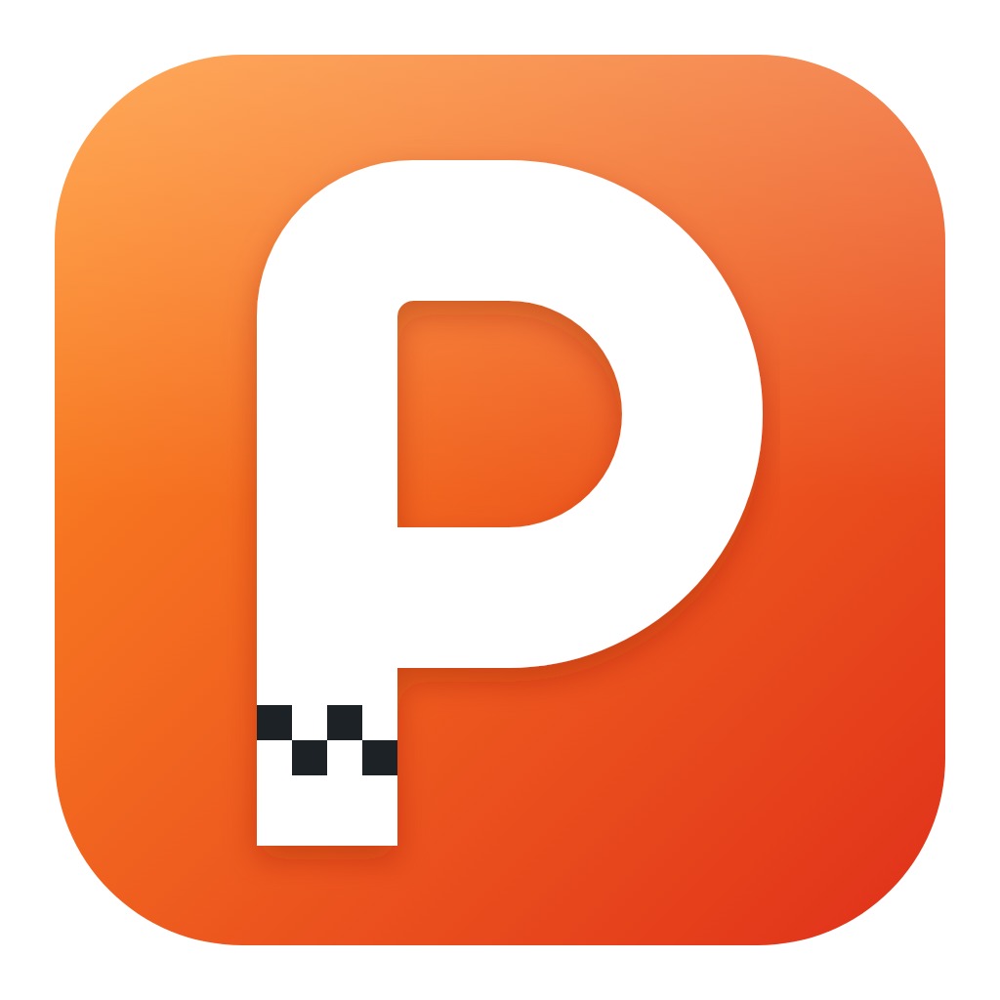
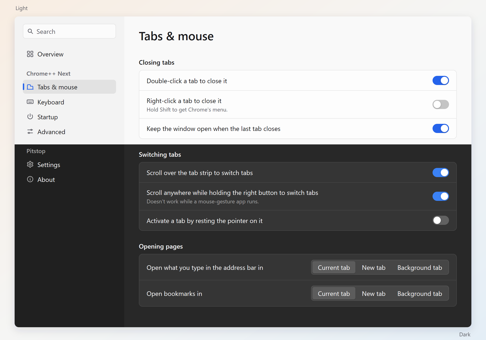
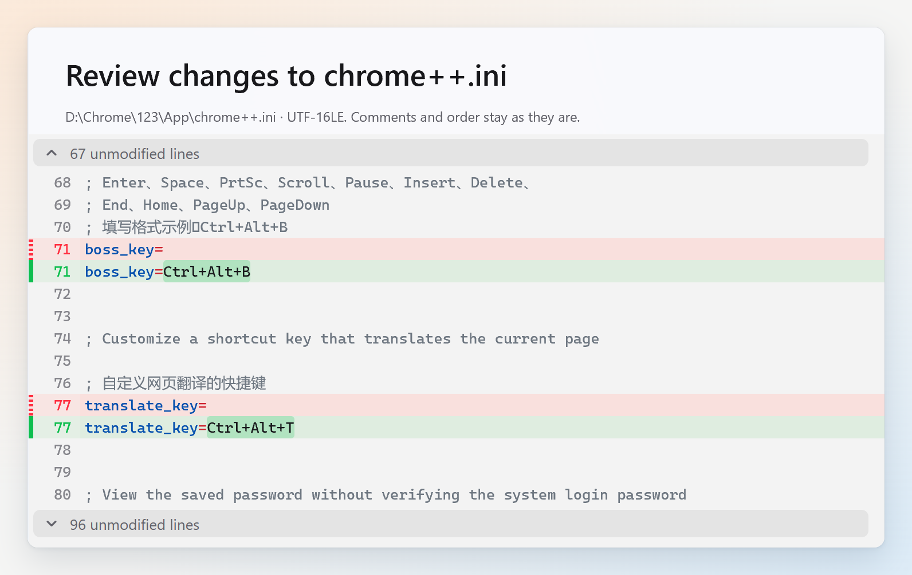

  

<h1 align="center">Pitstop</h1>

  Chrome++ Next configuration and portable Chrome management for Windows.

  <a href="https://github.com/Bush2021/pitstop/releases">Download</a> ·
  <a href="README.zh-CN.md">简体中文</a>

## Features

- **Native and lightweight**: Built with [MyGo](https://github.com/egoist/mygo), with low memory usage, Mica, and light and dark themes.
- **Graphical configuration**: Manage [Chrome++ Next](https://github.com/Bush2021/chrome_plus) settings without editing INI files by hand. Configure tab and mouse behavior, hotkeys and startup options, including double-click tab closing, wheel tab switching, the boss key and page translation.
- **Updates and rollback**: Manage Chrome and Chrome++ Next updates with manual, ask-first and automatic modes. Keep replaced versions by default, with portable-profile backups before milestone updates.
- **Portable**: Chrome, its profile and Pitstop's settings stay in one folder by default. English and Simplified Chinese interfaces are included.

Settings support search in either language, shortcut recording and Chrome command selection. Changes are saved to `chrome++.ini`, preserving comments, key order and encoding. A diff preview is available before saving, and each save keeps a backup.

Background and in-app updates require Chrome++ Next 1.19.0 or later with `managed_updates` support. Older versions support manual updates.

Profile backups cover only the portable `Data` folder. Switching back across milestones restores the matching profile copy; changes made in the newer profile stay with that profile.

## Download and use

1. Download `pitstop.exe` from [Releases](https://github.com/Bush2021/pitstop/releases).
2. Place it in a folder for Chrome. For an existing portable install, place it next to the `App` folder.
3. Run Pitstop, select a Chrome channel and architecture, then select **Set up**.

Pitstop is a portable application for Windows x64. Updates are manual by default. Use a folder rather than a drive root; self-updates also require write access to its parent.

## License

[GPL-3.0-or-later](LICENSE)
