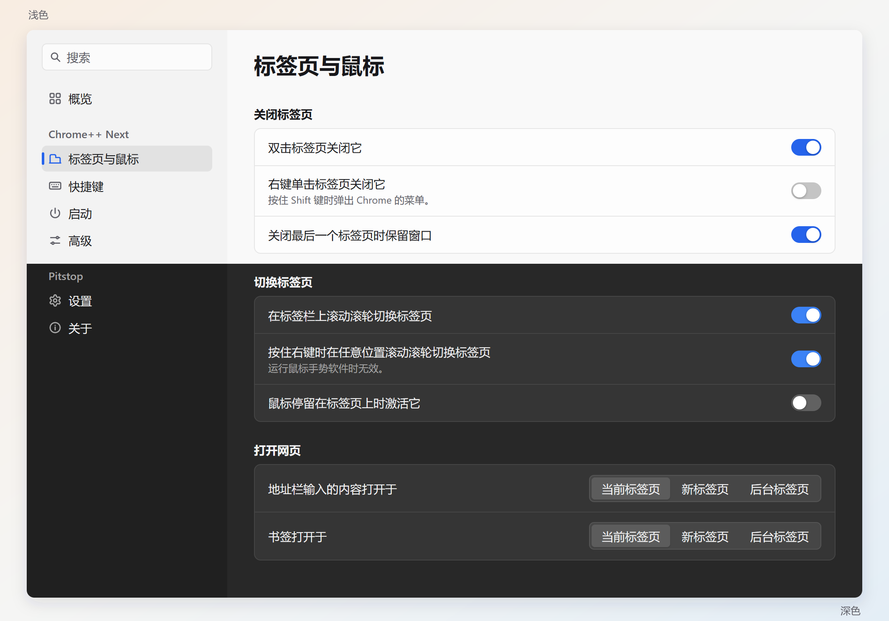
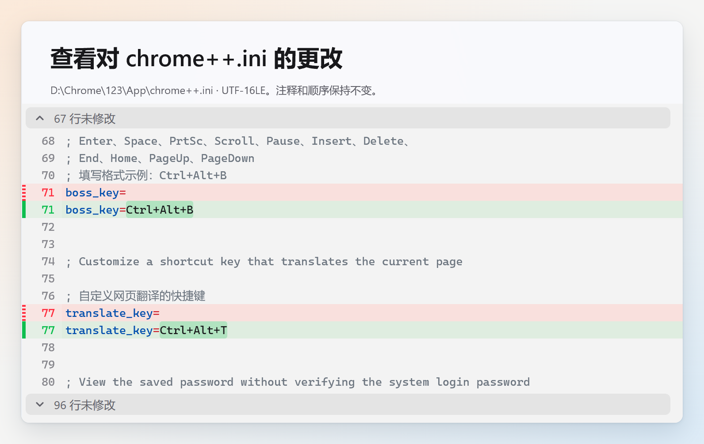

  

<h1 align="center">Pitstop</h1>

  Chrome++ Next 图形化配置与便携版 Chrome 管理工具

  <a href="https://github.com/Bush2021/pitstop/releases">下载</a> ·
  <a href="README.md">English</a>

## 特性

- **原生轻量**：基于 [MyGo](https://github.com/egoist/mygo) 构建，内存占用低，支持 Mica 效果及浅色、深色主题。
- **图形化配置**：将 [Chrome++ Next](https://github.com/Bush2021/chrome_plus) 的 INI 选项整理为设置页面，涵盖标签页、鼠标、快捷键与启动行为。双击关闭标签页、滚轮切换、老板键、网页翻译等功能均可在界面中配置。
- **更新与回退**：管理 Chrome 和 Chrome++ Next 的更新，支持手动、询问和自动模式。询问和自动模式下，Chrome 运行时的更新都通过 Chrome 自带的“重新启动以更新”完成。默认保留被替换的版本。
- **便携使用**：默认将 Chrome、用户数据和 Pitstop 设置保存在同一文件夹，提供简体中文和英文界面。

设置项支持中英文搜索，快捷键与 Chrome 命令可通过录制、选择完成配置。修改保存到 `chrome++.ini`，保留原有注释、顺序和编码，并提供保存前的差异预览及自动备份。

后台与应用内更新需要支持 `managed_updates` 的 Chrome++ Next 1.19.0 或更新版本。旧版仍支持手动更新。

## 下载与使用

1. 从 [Releases](https://github.com/Bush2021/pitstop/releases) 下载程序：x64 系统下载 `pitstop.exe`；32 位或 ARM 版 Windows 下载 `pitstop-x86.zip` 或 `pitstop-arm64.zip`，解压出 `pitstop.exe`。请勿改名，自更新按 `pitstop.exe` 这个文件名替换程序。
2. 将程序放入 Chrome 所在的文件夹。已有便携版 Chrome 时，与 `App` 文件夹放在同一级；首次部署可使用空文件夹。
3. 运行 Pitstop，选择 Chrome 渠道和架构后，点击 **部署**。

Pitstop 为便携式程序，支持 Windows x64、x86 和 ARM64，默认手动更新。请放在文件夹内，避免直接放在盘符根目录；自更新还需要能写入该文件夹的上一级目录。

## 许可证

[GPL-3.0-or-later](LICENSE)
